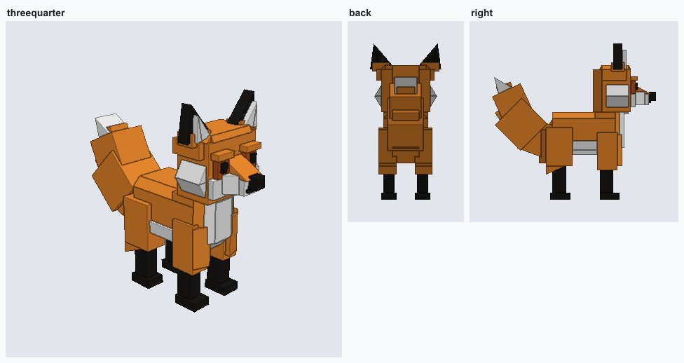
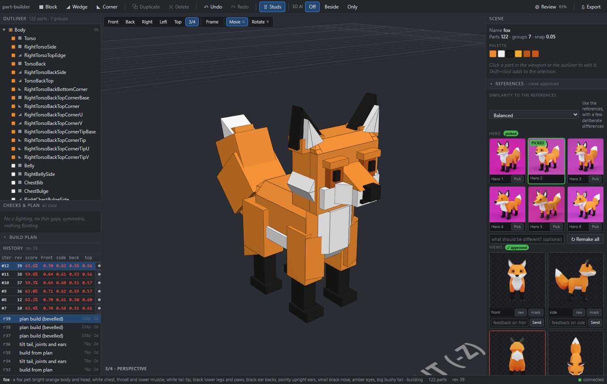
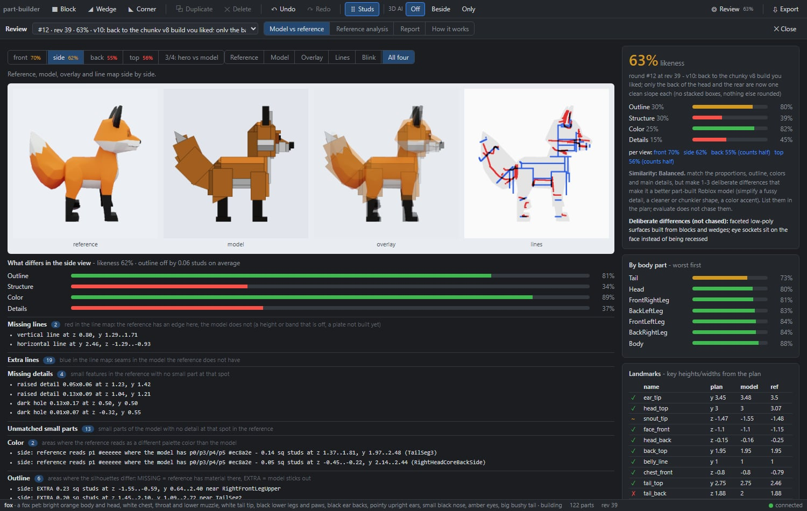

# part-builder

Describe a Roblox model in words and get it back built from native Roblox parts (blocks, wedges,
corner wedges), rigged and ready for Studio.



## How it works
1. AI draws your idea, or you bring your own picture. You pick the one you like.
2. It makes front, side and back views of it (or you upload them). You approve them.
3. Claude builds the model from parts, compares it with the views and fixes it until it
   matches. You watch it happen in the editor.
4. You get a rigged `.rbxmx` file, or the model is pushed straight into Roblox Studio.

The editor: the model, its parts and the reference pictures.


The review screen: reference, model, overlay and line map for each view, with the score.


## You need
- [Claude Code](https://claude.com/claude-code)
- Node.js (24 tested)
- An image source: ComfyUI on your own GPU (free), or an API key from Gemini, OpenAI, fal.ai or
  Replicate (paid, a few cents per image). Or none: use your own pictures.
- Roblox Studio (optional)

## Setup
```
npm install
npm run build:web
cp .env.example .env
```
1. Set your image source in `.env` (the options are listed there). For ComfyUI, see
   [docs/local-gpu.md](docs/local-gpu.md).
2. Start Claude Code in this folder and allow the `part-builder` MCP server.
3. Optional: in Roblox Studio, open Assistant Settings > MCP Servers > Quick connect and turn
   on Claude Code ([Roblox docs](https://create.roblox.com/docs/studio/mcp)).

## Use
Ask Claude Code something like *"make a blocky fox, about 3 studs tall"*. Open the editor link
it gives you to pick the picture, approve the views and watch the build.

- Your own pictures: give Claude the file path, or use the Upload buttons in the editor's
  References panel. A transparent PNG, or a plain background in a color the model doesn't use,
  works best.
- Results: `projects/<name>/`. The Roblox file is `exports/<name>.rbxmx` (Studio: right-click
  Workspace > Insert from File).
- Look: presets in `styles/`. Drop up to 6 example screenshots into a preset's folder to steer
  the pictures.
- No image source yet? Set `PART_BUILDER_FAKE_IMAGES=1` to try it with a demo knight.

## My setup
- A Windows laptop running Claude Code and Roblox Studio.
- A second PC with an RTX 3090 running Comfy Desktop, reached over Tailscale. The laptop
  starts ComfyUI on it over SSH when it needs pictures (`COMFYUI_SSH` in `.env`), and it shuts
  down when idle.
- FLUX.2 klein 4B for the first pictures, Qwen-Image-2.1 with the Multiple-Angles LoRA for the
  views.
- Studio connected with Quick connect, so finished models go straight in.

## License
MIT. The AI models have their own licenses: Qwen-Image, used by the default ComfyUI setup, is
non-commercial ([details](docs/local-gpu.md#models)). Stud textures:
[THIRD_PARTY_NOTICES.md](THIRD_PARTY_NOTICES.md).

Not affiliated with Roblox.

## Development
`npm test` and `npm run typecheck`. Code layout and conventions: [CLAUDE.md](CLAUDE.md).
